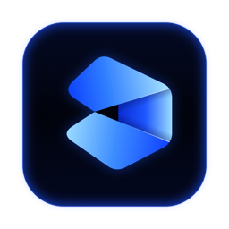

<p align="center"></p>

<h1 align="center">Stitchy</h1>

<p align="center">A native Dynamic Island for the Mac: live activities, music, files, a lock screen player and your own no-code extensions, all in one notch.</p>

<p align="center">
  <a href="LICENSE"></a>
  
  
</p>

Stitchy draws a black island attached to the top of your display, on Macs with or
without a notch. Hover or click it and it grows into one continuous surface with
music, timers, a file and clipboard shelf, notes, calendar, weather, tools, a
launcher and tabs you build yourself.

Swift 6, SwiftUI and AppKit. No third-party dependencies and no web views.

## Highlights

- **Live activities** for music, timers, downloads, AirDrop, charging, Bluetooth,
  drives, camera/mic use, Focus, coding agents and Xcode builds, with side bubbles
  when several run at once.
- **Music:** Apple Music and Spotify with artwork, scrubbing, Up Next and synced
  lyrics, plus a full-screen **lock screen player** with an Apple-style lyrics panel.
- **Shelf and clipboard:** drop files in, drag them out, zip, convert, compress,
  merge PDFs; searchable clipboard history with pins (opt-in, password managers excluded).
- **Everyday tools:** calendar, weather, notes (Apple Notes), Pomodoro, calculator,
  developer tools, screen text capture, translate, window snapping, per-app volume.
- **Extensions:** build your own island tabs from any JSON API or RSS feed with a
  visual editor. No code, tokens in the Keychain, shareable `.stitchyext` files.
- **Private by design:** permissions are asked only when you turn a feature on,
  nothing is uploaded, and Touch ID can lock sensitive sections.

## Install

Stitchy isn't notarized yet, so build it yourself:

```bash
git clone <this repository> stitchy && cd stitchy
Scripts/build-app.sh --install
```

Needs macOS 14 Sonoma or later and the Swift 6 toolchain (Xcode 16+ or the Command
Line Tools). See [Building](docs/BUILDING.md) for signing, tests and debugging.

## Using it

| Action | Result |
|---|---|
| Hover the island | Expands; collapses when the pointer leaves |
| Click the island | Expands and stays open |
| Esc or click elsewhere | Collapses |
| ⌃⌥Space (configurable) | Opens the launcher |
| Drag files toward the island | Opens the Shelf as a drop target |
| Menu bar icon | Open Stitchy, Show/Hide Island, Settings, Quit |

## Documentation

| Guide | What's in it |
|---|---|
| [Features](docs/FEATURES.md) | Everything Stitchy does, page by page, and known limitations |
| [Extensions](docs/EXTENSIONS.md) | Building extensions: data sources, components, automations, sharing, file format |
| [Privacy & permissions](docs/PRIVACY.md) | Every permission, every network service, what's stored where |
| [Building](docs/BUILDING.md) | Build, sign, test, regenerate the icon, debug |
| [Architecture](docs/ARCHITECTURE.md) | How the code is organised and why |
| [Testing](docs/TESTING.md) | What's covered by tests and what was verified by hand |
| [Roadmap](docs/ROADMAP.md) | Feature audit and phase history |
| [Changelog](CHANGELOG.md) | Release notes |
| [Contributing](CONTRIBUTING.md) | How to help |
| [Security](SECURITY.md) | Reporting vulnerabilities |

## License

Copyright © 2026 Stitchy contributors.

Stitchy is free software: you can redistribute it and/or modify it under the terms
of the GNU General Public License as published by the Free Software Foundation,
either version 3 of the License, or (at your option) any later version.

Stitchy is distributed in the hope that it will be useful, but WITHOUT ANY
WARRANTY; without even the implied warranty of MERCHANTABILITY or FITNESS FOR A
PARTICULAR PURPOSE. See the [GNU General Public License](LICENSE) for more details.

SPDX-License-Identifier: `GPL-3.0-or-later`

Third-party code: the lock screen presenter adapts part of
[SkyLightWindow](https://github.com/Lakr233/SkyLightWindow) by Lakr Aream under the
MIT License, which is GPL-compatible; its notice is in
[`ThirdParty/SkyLightWindow-LICENSE`](ThirdParty/SkyLightWindow-LICENSE).

Apple Music, Spotify, Hacker News, GitHub and other names are trademarks of their
owners. Stitchy isn't affiliated with them and bundles none of their logos.
